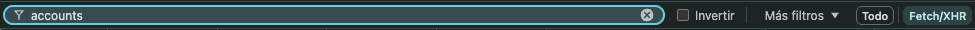

# Cómo obtener el JWT y los identificadores de tu cuenta y contrato

`gbm download` usa la misma API que la página de GBM para bajar tus estados de cuenta. Para eso necesita
tres datos que se copian de las herramientas de desarrollador del navegador mientras tienes la sesión abierta, y que
se guardan en un archivo local, `private/credentials.env` (nunca con `export` ni en la línea de comandos, para que no
queden en el historial de tu terminal):

| Dato | Clave en el archivo | Qué es | Dónde está |
|---|---|---|---|
| JWT temporal | `GBM_TOKEN` | Tu sesión iniciada | Encabezado `Authorization` de la petición |
| Cuenta | `GBM_ACCOUNT_ID` | Tu cuenta completa de GBM (una por persona) | En la **ruta** de la petición: `.../dashboard/contracts/<GBM_ACCOUNT_ID>/accounts` |
| Contrato | `GBM_CONTRACT_ID` | Cada contrato de trading dentro de tu cuenta; cada uno tiene sus propios estados de cuenta | En la **respuesta**: campo `account_id` del contrato con tu `name` |

## Cuenta vs. contrato: GBM usa los nombres al revés

En este proyecto usamos los nombres como los piensa un usuario: la **cuenta** es tu cuenta completa de GBM y cada
**contrato** es uno de tus contratos de trading (por ejemplo, uno personal y otro de un producto específico), con
sus propios estados de cuenta. La API de GBM los nombra justo al revés, así que vas a ver nombres que parecen
contradecir esta guía:

| En este proyecto | En las rutas de la API de GBM | En la respuesta de `.../accounts` |
|---|---|---|
| `GBM_ACCOUNT_ID` (cuenta) | va después de `/contracts/` | no aparece: es el UUID de la ruta de la petición |
| `GBM_CONTRACT_ID` (contrato) | va después de `/accounts/` | campo `account_id` de cada contrato |

Las dos rutas que importan:

```
Lista de contratos:      GET https://api.appgbm.com/v1/dashboard/contracts/<GBM_ACCOUNT_ID>/accounts
Estados de cuenta:       GET https://api.appgbm.com/v1/legal-documents/contracts/<GBM_ACCOUNT_ID>/accounts/<GBM_CONTRACT_ID>/account-statements?year=2026&month=7&fileFormat=pdf
```

No tienes que traducir nada: copia cada valor a la clave que dice esta guía y `gbm download` arma la ruta en el orden
que espera GBM. Si los pones invertidos en el archivo, GBM responde "no encontrado" para todos los meses;
`gbm download` lo detecta, **prueba con los valores intercambiados y, si así sí encuentra tus estados de cuenta,
sigue con ellos** y te lo dice en la terminal. Esto sólo pasa cuando con los valores del archivo no encontró
**ningún** estado de cuenta; si encontró al menos uno, nunca intercambia nada.

```
Aviso: GBM_ACCOUNT_ID y GBM_CONTRACT_ID parecen estar invertidos en el archivo de credenciales: ...
Sigo con los valores intercambiados ...
...
Usé GBM_ACCOUNT_ID y GBM_CONTRACT_ID intercambiados. Si vas a reutilizar el archivo de credenciales, intercambia esos
dos valores en él para que la próxima vez no haga falta.
```

El archivo no se modifica. Si ni en un orden ni en el otro hay estados de cuenta, se detiene sin borrar el archivo de
credenciales para que revises los valores.

> Esto describe la API de GBM tal como funcionaba al escribir esta guía (octubre 2026). No es una API pública ni
> documentada por GBM: puede cambiar sin aviso. Si `gbm download` deja de funcionar, revisa en la pestaña Red del
> navegador cómo se ven hoy estas rutas.

> **El JWT da acceso a tu cuenta.** No lo compartas ni lo subas a git; sólo va en `private/credentials.env`
> (ignorado por git) y **borra ese archivo en cuanto termine la descarga**. El JWT caduca en poco tiempo (alrededor de
> una hora); cuando expire, `gbm download` se detiene con un aviso y basta con copiar uno nuevo al archivo. Al
> terminar también puedes cerrar sesión en GBM para invalidarlo.

## Pasos

1. **Inicia sesión** en tu cuenta de GBM en <https://www.appgbm.com>.

2. **Abre las herramientas de desarrollador** del navegador (`⌥⌘I` en macOS, `F12` o `Ctrl+Shift+I` en Windows/Linux)
   y ve a la pestaña **Red** (*Network*).

3. **Filtra las peticiones**: elige el tipo **Fetch/XHR** y escribe `accounts` en el cuadro de filtro.

   

4. **Abre "Estados de cuenta y constancias"** desde el menú lateral (hamburguesa), o entra directo a
   <https://www.appgbm.com/tax-documents>. En la lista de la pestaña Red aparece una petición **GET** (si no aparece, ve a la "Trading" <https://www.appgbm.com/trading/MEX> e intenta ir de nuevo a tus estados de cuenta y constancias). Haz clic en ella:
   - **JWT**: en *Encabezados* → *Encabezados de solicitud*, copia el valor de `authorization` **sin** la palabra `Bearer`
     (empieza con `eyJ...`).
   - **Cuenta (`GBM_ACCOUNT_ID`)**: está en la **ruta** de la petición HTTP GET, en *Encabezados* → *URL de solicitud*:
     `https://api.appgbm.com/v1/dashboard/contracts/<GBM_ACCOUNT_ID>/accounts`. Es un UUID (como `a1b2c3d4-...`).
   - **Contrato (`GBM_CONTRACT_ID`)**: está dentro de la **respuesta** de la petición (*Respuesta* o *Vista previa*).
     Ahí verás uno o varios contratos: busca el que quieras evaluar por su `name` y copia su campo `account_id`
     (sí, GBM lo llama `account_id`; ver "Cuenta vs. contrato" arriba).
   - Si tienes varios contratos, la idea es separarlos por `,` en `GBM_CONTRACT_ID`, pero **eso todavía no está
     soportado**: por ahora procesa un contrato a la vez (ver "Varios contratos").

5. **Guarda las credenciales en un archivo.** En la terminal, dentro de este repositorio:

   ```bash
   cp config/credentials.example.env private/credentials.env
   ```

   ```bash
   chmod 600 private/credentials.env
   ```

   Abre `private/credentials.env` en tu editor y pega los tres valores:

   ```
   GBM_TOKEN=eyJ...
   GBM_ACCOUNT_ID=a1b2c3d4-...     # UUID de la ruta .../dashboard/contracts/<aquí>/accounts
   GBM_CONTRACT_ID=e5f6a7b8-...    # account_id del contrato, en la respuesta
   ```

   Si prefieres no guardar el JWT en el archivo, deja `GBM_TOKEN=` vacío: `gbm download` te lo pedirá sin mostrarlo.

6. **Descarga** y borra las credenciales al terminar:

   ```bash
   uv run gbm download --delete-credentials
   ```

   `--delete-credentials` borra `private/credentials.env` al terminar (también si la descarga se detiene por un
   error). Sin esa opción el archivo se conserva y la terminal te recuerda borrarlo:

   ```bash
   rm private/credentials.env
   ```

## Qué hace la descarga

- Pide el estado de cuenta de cada mes, empezando por el actual y yendo hacia atrás, hasta el más antiguo que GBM
  tenga disponible. El mes en curso (y a veces el anterior) aún no está publicado: esos meses se saltan sin contar.
- Se detiene cuando GBM responde **3 meses seguidos** que no hay estado de cuenta (`--max-misses` para cambiarlo).
  Si GBM responde con un error (token vencido, 5xx, red), **se detiene con un mensaje en vez de asumir que ya no hay
  más meses**; al volver a correrlo se saltan los que ya están descargados.
- Guarda cada mes como `private/statements/YYYY-MM.pdf`. La carpeta `private/` está en `.gitignore`: tus estados de
  cuenta (con tu nombre, RFC, domicilio y CLABE) nunca se suben al repositorio.
- Opciones: `--since 2022-01` para no bajar de cierto mes, `--until 2025-12` para empezar en otro mes.

## Varios contratos

Por ahora cada contrato se procesa por separado (mismo `GBM_ACCOUNT_ID`, distinto `GBM_CONTRACT_ID`), en su propia
carpeta dentro de `private/` (así sigue ignorada por git), con su propio `credentials.env`:

```bash
mkdir -p private/otro-contrato && cp config/credentials.example.env private/otro-contrato/credentials.env
```

Llena `private/otro-contrato/credentials.env` y corre:

```bash
uv run gbm --data-dir private/otro-contrato download --delete-credentials
```

```bash
uv run gbm --data-dir private/otro-contrato all
```

Combinar varios contratos en un solo dashboard no está soportado todavía: los traspasos entre contratos se verían
como depósitos y retiros externos.

## Problemas comunes

| Mensaje | Qué hacer |
|---|---|
| `GBM rechazó el token (401/403)` | El JWT expiró. Copia uno nuevo a `private/credentials.env` (con o sin `Bearer`, da igual). |
| `No encontré private/credentials.env` | Crea el archivo a partir de `config/credentials.example.env` (paso 5). |
| `GBM_ACCOUNT_ID y GBM_CONTRACT_ID parecen estar invertidos` | Nada: la descarga siguió con los valores intercambiados. Si reutilizas `private/credentials.env`, intercambia ahí los dos valores. |
| `No encontré estados de cuenta en los últimos meses` | Revisa que la cuenta sea la de la ruta y el contrato sea el `account_id` del `name` correcto. La línea "Respuestas de GBM" muestra qué contestó GBM en cada mes. El archivo no se borró. |
| `GBM respondió 429/5xx` | Espera unos minutos y vuelve a correrlo. |
